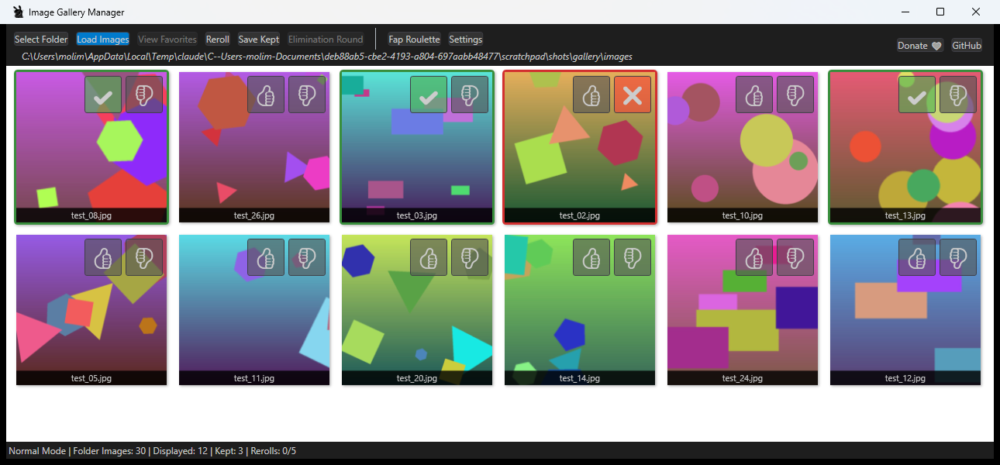

# Image Gallery App

A WPF desktop app (.NET 8) for working through a big folder of images: show a random batch, mark the ones to keep or blacklist, reroll the rest, and narrow down to a final pick.
This is perfect for people who have too many images in a reference folder, or who want a random browsing experience of their local files. Force yourself to pick something and work with it rather than getting lost in the sea of endless choices. 



*Screenshot uses generated test images.*

## Features

- **Load Images** picks a random batch from the selected folder (the folder is indexed once and cached)
- 👍 keep / 👎 blacklist each image; blacklisted images don't come back
- **Reroll** swaps out the images you haven't kept, up to a set number of rerolls
- **Elimination Round** narrows your kept images down to a target count
- **Save Kept** copies the kept images to a folder of your choice
- Favourites, a roulette mode, and a full-size viewer
- Settings for batch size, reroll limit, thumbnail size and more

Settings, favourites and the image index are stored in `%APPDATA%\ImageGalleryApp\`.

## Build and run

Requires the .NET 8 SDK on Windows.

```bash
dotnet run
```

Or open `ImageGalleryApp.sln` in Visual Studio.
